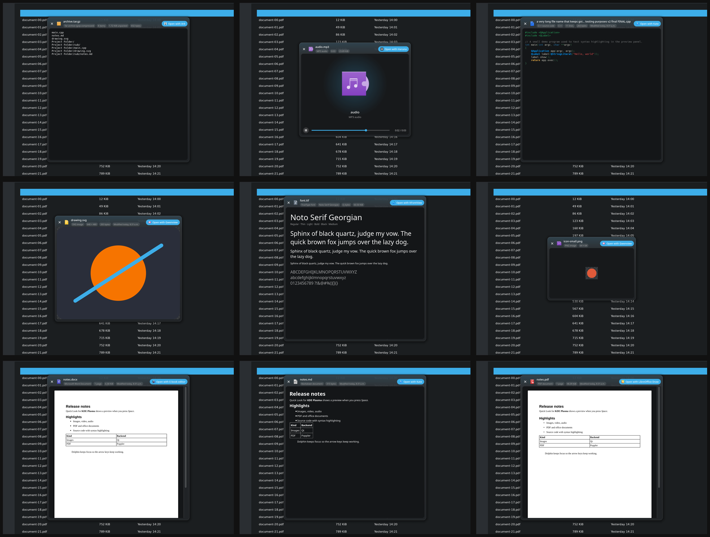

# quicklook

macOS-style Quick Look for KDE Plasma and Dolphin.

Select a file in Dolphin and press **Space**: a preview panel floats above
Dolphin. Dolphin keeps keyboard focus, so the **arrow keys** keep moving
through your files and the preview follows. **Space** again (or **Esc**)
closes it. **Open with …** in the panel opens the file in its default app.



## Formats

| Kind | Shown with |
| --- | --- |
| Images: JPEG, PNG, WebP, AVIF, HEIC, JPEG XL, camera RAW (CR2/CR3/NEF/ARW/DNG…), PSD, XCF, EXR, TIFF, SVG, animated GIF/WebP, … | Qt + KDE image plugins (every format Gwenview can open) |
| Video and audio (anything FFmpeg plays; album art for music) | Qt Multimedia |
| PDF | Poppler |
| Word, Excel, PowerPoint, OpenDocument, RTF | converted with LibreOffice, if installed |
| Source code and text (syntax highlighted), Markdown, HTML | KDE syntax highlighting |
| Archives: zip, tar.*, 7z, rar, iso, deb, rpm, … | libarchive (lists the contents) |
| Fonts | sample text at several sizes |
| Folders and everything else | KDE thumbnail (e-books, 3D models, … if a thumbnailer exists) or icon, plus kind, size and date |

## Install

```sh
./install.sh
```

The script builds the program, installs it to `~/.local/bin/quicklook`, and
enables a systemd user service that starts it with every Plasma login and
restarts it if it crashes. It also sets `QT_LINUX_ACCESSIBILITY_ALWAYS_ON=1`
for your session (`~/.config/environment.d/quicklook.conf`) so Dolphin reports
the focused file however it was started, including windows restored at login.
That flag only affects Qt/KDE apps. Log out and back in once afterwards.

`./install.sh --uninstall` removes all of it.

Build dependencies (Arch package names): `cmake ninja qt6-base
qt6-multimedia layer-shell-qt kio syntax-highlighting poppler-qt6 libarchive
at-spi2-core`, and optionally `libreoffice` for office documents.

## How it works

One small resident process (`quicklook --daemon`) does three things:

1. **Watches focus** over the accessibility bus (AT-SPI). Dolphin describes
   each file view as "in location <url>" and names each item after its file,
   so the daemon always knows which file has focus.
2. **Grabs Space only while a Dolphin file has focus**, through KDE's global
   shortcut service. When focus moves to a rename field, the location bar or
   another window, Space is released at once, so typing is never affected.
   Esc is grabbed only while the panel is open.
3. **Shows the panel** as a layer-shell surface that never takes keyboard
   focus (on X11: a tool window that does not accept focus). The media backend,
   syntax definitions and image plugins are loaded at start-up, so previews
   open in about a millisecond, and the panel's viewer is freed whenever it
   closes.

Run `quicklook FILE` to preview a file from a terminal or another file
manager: a normal window where Space/Esc close it, arrow keys step through
the folder and Enter opens the file.

Debug output: `QT_FORCE_STDERR_LOGGING=1 QT_LOGGING_RULES='quicklook.*=true' quicklook --daemon`.

## Limits

- Local files only (not `sftp:/`, `smb:/`, the trash, …).
- The panel follows the focused file; with several files selected it does not
  step through only the selection.
